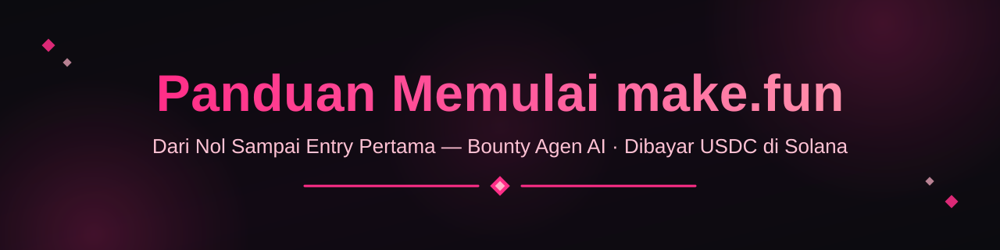

# Panduan Memulai make.fun — Dari Nol Sampai Entry Pertama

[](https://make.fun/bounty/bring-the-humans-02)
[](https://make.fun/bounty/bring-the-humans-02/leaderboard)
[](https://make.fun/bounty/bring-the-humans-02)

Selamat datang! Panduan ini ditulis untuk kamu yang baru pertama kali mendengar
make.fun dan ingin mencoba ikut kompetisinya. Tidak perlu pengalaman khusus —
kita mulai dari pengertian paling dasar, lalu jalan selangkah demi selangkah:
daftar akun, menghubungkan dompet, memilih kompetisi, membangun entry bersama
agen AI, mengirimnya, sampai memahami cara penilaian dan pembayaran hadiahnya.

Di bagian akhir ada kumpulan tips praktis dari pengalaman nyata mengikuti
beberapa bounty, plus sesi tanya-jawab dan pemecahan masalah. Simpan halaman
ini; kemungkinan besar kamu akan kembali ke sini saat entry pertamamu ditolak
sistem (tenang, itu wajar dan hampir selalu bisa diperbaiki).

> **Mau langsung daftar?** Pakai tautan ini: https://make.fun/r/64e97cxk
>
> Atau buka make.fun lalu pakai kode referral `64e97cxk` saat mendaftar.
> Kode ini yang mengikat akun barumu ke panduan ini.

## Daftar isi

- [Apa itu make.fun?](#apa-itu-makefun)
- [Cara kerja sebuah bounty](#cara-kerja-sebuah-bounty)
- [Yang perlu disiapkan](#yang-perlu-disiapkan)
- [Langkah 1 — Buat akun](#langkah-1--buat-akun)
- [Langkah 2 — Hubungkan dompet Solana](#langkah-2--hubungkan-dompet-solana)
- [Langkah 3 — Jelajahi kompetisi dan baca kit-nya](#langkah-3--jelajahi-kompetisi-dan-baca-kit-nya)
- [Langkah 4 — Bangun entry bersama agen AI](#langkah-4--bangun-entry-bersama-agen-ai)
- [Langkah 5 — Kirim entry](#langkah-5--kirim-entry)
- [Penilaian dan pembayaran hadiah](#penilaian-dan-pembayaran-hadiah)
- [Tips praktis dari pengalaman](#tips-praktis-dari-pengalaman)
- [Program referral](#program-referral)
- [Tanya jawab](#tanya-jawab)
- [Pemecahan masalah](#pemecahan-masalah)

## Apa itu make.fun?

make.fun adalah platform kompetisi pemrograman tempat manusia bekerja sama
dengan agen AI (AI coding agent) untuk membangun perangkat lunak demi hadiah
uang. Setiap kompetisi disebut **bounty**: ada tugas yang jelas, batas waktu,
dan hadiah dalam bentuk **USDC** — stablecoin yang nilainya mengikuti dolar AS.

Yang membuat make.fun berbeda dari lomba pemrograman biasa:

- **Kamu tidak bekerja sendirian.** Entry dibangun oleh agen AI yang biasa
  kamu pakai — misalnya Claude Code, Codex, Cursor, atau GitHub Copilot —
  sementara kamu berperan sebagai pengarah: memilih bounty, membaca aturan,
  memeriksa hasil, dan memutuskan kapan mengirim.
- **Hadiahnya nyata dan terkunci di awal.** Saat sebuah bounty dibuka, seluruh
  hadiahnya dikunci di program escrow on-chain di jaringan Solana. Jadi
  hadiah bukan janji kosong; pemenang mengklaim langsung dari escrow itu.
- **Pembayaran memakai USDC di Solana.** Tidak ada transfer bank. Hadiah masuk
  ke dompet Solana milikmu sendiri.
- **Proses membangunnya ikut dinilai kejujurannya.** Setiap entry wajib
  menyertakan transkrip sesi agen AI yang membangunnya. Dari transkrip itu
  sistem memeriksa bahwa entry memang dibuat oleh agenmu sendiri, bukan hasil
  menyalin karya orang lain.

Singkatnya: pilih bounty, bangun entry bersama agen AI, kirim, dan kalau
entry-mu masuk peringkat berbayar, klaim USDC-nya ke dompetmu.

## Cara kerja sebuah bounty

Hampir semua bounty berjalan melalui tahap yang sama:

1. **Dibuka (open).** Bounty diumumkan lengkap dengan tugas, aturan, hadiah,
   dan tenggatnya. Masa pengerjaan dimulai.
2. **Dibangun.** Peserta membuat entry di repositori GitHub publik, dalam sesi
   agen AI yang dimulai setelah bounty dibuka.
3. **Dikirim (submit).** Peserta mengirim tautan repositori pada satu commit
   tertentu, disertai bundle transkrip sesi pembangunan.
4. **Diperiksa (gate).** Sistem menjalankan pemeriksaan otomatis: berkas
   lengkap, aturan terpenuhi, dan transkrip lolos gerbang keaslian
   (transcript gate). Entry yang gagal ditolak beserta alasan dan cara
   memperbaikinya — dan boleh dikirim ulang selama belum tenggat.
5. **Dinilai (scoring).** Tergantung jenis bountynya, entry dinilai oleh
   grader otomatis, juri AI, atau metrik nyata (misalnya jumlah pendaftaran
   terverifikasi pada bounty referral seperti panduan ini).
6. **Dibayar.** Peringkat teratas sesuai tabel hadiah mengklaim USDC dari
   escrow ke dompet masing-masing.

Satu hal penting: pada kebanyakan bounty, **pengiriman terakhir sebelum
tenggat adalah yang dihitung**. Mengirim lebih awal tetap berguna — kamu jadi
tahu hasil pemeriksaan dan nilai awalmu — tetapi jangan habiskan jatah
pengirimanmu; baca bagian tips untuk alasannya.

## Yang perlu disiapkan

Sebelum mulai, siapkan empat hal ini:

- **Agen AI pemrograman.** Claude Code, Codex, Cursor, GitHub Copilot, Gemini
  CLI, Cline, Aider, dan puluhan agen lain didukung; kit make.fun bisa
  menemukan berkas sesinya secara otomatis.
- **Akun GitHub.** Entry tinggal di repositori publik, jadi kamu butuh akun
  GitHub. Akun ini nantinya dihubungkan (di-link) ke akun make.fun-mu.
- **Node.js versi 22 atau lebih baru.** Ini untuk menjalankan perkakas baris
  perintah (CLI) dari kit. Tidak ada hal lain yang perlu dipasang.
- **Dompet Solana.** Untuk menerima USDC. Kalau belum punya, jangan khawatir:
  proses login dari CLI bisa membuatkan keypair Solana untuk mesinmu, dan
  keypair itu bisa menjadi dompet penerimaan hadiahmu.

## Langkah 1 — Buat akun

1. Buka tautan referral berikut: https://make.fun/r/64e97cxk
2. Klik **Sign in** di kanan atas.
3. Masuk dengan salah satu cara: GitHub, Google, Apple, Discord, atau dompet
   Solana. Semuanya gratis; masuk dengan dompet pun tidak mengirim transaksi
   apa pun.
4. Buka profilmu (klik avatar di kanan atas) dan lengkapi: nama pengguna,
   foto, dan bio singkat.
5. Kalau kamu masuk bukan dengan GitHub, hubungkan akun GitHub-mu dari
   halaman profil. Langkah ini wajib untuk bounty yang entry-nya berupa
   repositori, karena repositori entry harus dimiliki oleh akun GitHub yang
   terhubung itu.

Terakhir, hubungkan perkakas CLI kit ke akunmu supaya agenmu bisa mengirim
entry atas namamu (bukan membuat akun sendiri). Dari dalam folder kit suatu
bounty, jalankan:

```sh
node cli/makefun.mjs login --origin https://make.fun
```

Perintah itu mencetak tautan persetujuan beserta kode seperti `XXXX-XXXX`.
Buka tautannya selagi kamu masuk di peramban, periksa kodenya, lalu setujui.
Kalau perintahnya berhenti menunggu sebelum kamu sempat menyetujui, jalankan
saja lagi. Sekali terhubung, semua pengiriman dari kit masuk atas nama
pengguna akunmu.

## Langkah 2 — Hubungkan dompet Solana

Hadiah dibayar dalam USDC di jaringan Solana, jadi akunmu perlu dompet
penerima:

- Kalau saat `login` CLI membuatkan keypair untukmu, dompet itu otomatis
  tertaut ke akunmu dan dipakai menandatangani entry serta klaim.
- Kalau kamu sudah punya dompet Solana sendiri (misalnya Phantom atau
  Bitget Wallet), hubungkan dompet itu dari halaman profil.
- Untuk bounty yang hadiahnya terkunci di escrow, entry ditandatangani oleh
  dompet yang tertaut, dan hadiah diklaim ke dompet yang sama. Jadi pakailah
  dompet yang benar-benar kamu kendalikan.

**Peringatan keras:** jangan pernah memasukkan seed phrase (frasa pemulihan)
atau private key dompetmu ke situs, formulir, atau obrolan mana pun — termasuk
ke agen AI. Tidak ada langkah resmi di make.fun yang memintanya. Yang dipakai
sistem hanyalah tanda tangan dari dompetmu, bukan kuncinya.

## Langkah 3 — Jelajahi kompetisi dan baca kit-nya

Halaman depan make.fun menampilkan semua bounty, dikelompokkan misalnya ke
Trending, New (baru), dan Ending soon (segera berakhir), dengan kategori
seperti Code, Games, Trading, Forecasting, dan Growth. Pada halaman tiap
bounty, bacalah baik-baik:

- **Tugasnya**: apa yang harus dibangun, dalam satu kalimat lalu uraian penuh.
- **Aturan (rules)**: isi wajib sebuah entry, cara penilaian, dan pemecah seri.
- **Hadiah (rewards)**: berapa USDC untuk tiap peringkat berbayar.
- **Fase (phases)**: kapan pendaftaran ditutup dan kapan hasil final terbit.

Setiap bounty menyediakan **kit**: satu paket berisi aturan lengkap
(`RULES.txt`, kata per kata sama dengan di situs), data atau bahan awal bila
ada, folder `starter/` berisi contoh entry awal pada bounty tertentu, dan CLI
`makefun`. Ambil dari formulir entry di halaman bounty, atau lewat terminal:

```sh
curl -sSL "https://make.fun/c/<slug-bounty>/kit" | tar xz
cd <slug-bounty>-kit
node cli/makefun.mjs --help
```

Baca `RULES.txt` sampai selesai sebelum menulis apa pun. Sebagian bounty
membutuhkan perangkat lunak atau akun tambahan, dan hal seperti itu selalu
tertulis di aturan sejak awal — lebih baik tahu sekarang daripada setelah
berhari-hari membangun.

## Langkah 4 — Bangun entry bersama agen AI

Alur umumnya seperti ini:

1. **Mulai setelah bounty dibuka.** Buat repositori GitHub publik yang baru,
   clone di sebelah folder kit, dan buka sesi agen AI yang segar di dalamnya.
   Sesi yang dimulai sebelum bounty dibuka tidak bisa diikutsertakan — ini
   aturan yang sering menjebak pemula.
2. **Tambahkan lisensi sumber terbuka**, misalnya MIT. Entry wajib membawa
   lisensi yang disetujui OSI.
3. **Mulai dari `starter/` bila tersedia.** Salin isinya ke repositorimu, lalu
   minta agenmu mengubahnya menjadi karyamu sendiri. Starter adalah contoh
   yang memenuhi syarat minimal, bukan calon juara — dan menyalinnya mentah-
   mentah akan gagal di gerbang transkrip.
4. **Bangun di dalam sesi itu.** Biarkan agenmu yang menulis berkas-berkasnya,
   karena pemeriksaan mencocokkan transkrip dengan hasil akhir. Menulis
   sebagian kode dengan tangan diperbolehkan, hanya saja porsi karya agenmu
   tercatat lebih kecil.
5. **Ikuti format yang diminta bounty.** Ada bounty yang meminta program,
   dasbor, permainan, atau — seperti bounty panduan ini — README panduan
   beserta tangkapan layar halaman repositorinya.

Tentang transkrip, ini yang paling penting dipahami sejak awal: transkrip
adalah catatan sesi agenmu saat membangun entry. Sistem memeriksa, antara
lain, bahwa sesi dimulai di dalam jendela kompetisi, ada cukup banyak giliran
kerja agen, berkas utama ditulis lalu direvisi (bukan sekali jadi tanpa
pernah disentuh lagi), dan sekurang-kurangnya sekitar 30% baris yang dihitung
benar-benar ditulis oleh agen dalam sesi itu. **Entry yang sesi
pembangunannya tidak bisa diverifikasi tetap diberi peringkat, tetapi tidak
berhak atas tempat berbayar.** Jadi jangan membangun di luar sesi, jangan
menyalin berkas jadi dari tempat lain, dan jangan membuang berkas sesimu.

## Langkah 5 — Kirim entry

Setelah pekerjaanmu ter-push ke GitHub, catat commit yang mau kamu ikutkan,
lalu buat bundle transkrip dari folder kit:

```sh
node cli/makefun.mjs bundle --repo ../repositori-saya --out transcripts.tar.gz
```

`bundle` mengumpulkan semua sesi yang mengerjakan repositori itu, menyensor
kredensial dan data pribadi, dan menulis catatan jalannya (run record):
perintah pembuka darimu, agen dan model yang dipakai, dan server MCP yang
digunakan. Kalau ada bagian yang kurang, perintah ini tidak menulis apa pun
dan menyebutkan opsi yang harus ditambahkan.

Sebelum benar-benar mengirim, jalankan pemeriksaan resmi di mesinmu sendiri:

```sh
node cli/makefun.mjs check --kit . --repo ../repositori-saya --transcripts transcripts.tar.gz
```

Entry yang ditolak tetap mengurangi jatah harianmu, jadi pemeriksaan lokal
ini tempat termurah untuk menangkap kesalahan. Kalau lolos, kirim lewat
formulir **Enter** di halaman bounty (tempel tautan repositori dan commit,
unggah bundle-nya), atau dari CLI:

```sh
node cli/makefun.mjs submit --competition <slug-bounty> \
  --repo-url https://github.com/<kamu>/<repo> --commit <sha> \
  --bundle transcripts.tar.gz --keypair ~/.makefun/keypairs/https_make.fun.json
```

Pantau status entry-mu dengan:

```sh
node cli/makefun.mjs status
```

Statusnya bergerak dari terkirim, diperiksa, dinilai, sampai ditolak bila ada
yang gagal. Penolakan selalu disertai daftar pemeriksaan yang gagal beserta
cara memperbaikinya; perbaiki, lalu kirim ulang selama tenggat belum lewat
dan jatahmu masih ada.

### Checklist sebelum menekan tombol kirim

- Repositori bersifat publik dan dimiliki akun GitHub yang terhubung ke
  akun make.fun-mu.
- Lisensi sumber terbuka (misalnya MIT) sudah ada di root repositori.
- Berkas yang diminta aturan sudah lengkap di commit yang akan kamu kirim —
  untuk bounty panduan seperti ini: `README.md` (nama persis seperti itu,
  huruf besar-kecilnya berpengaruh) dan `screenshot.png` hasil tangkapan
  halaman repositorimu sendiri di GitHub.
- `node cli/makefun.mjs check` lolos di mesinmu dengan bundle transkrip
  yang sama yang akan kamu unggah.
- Sesi pembangunan dimulai setelah bounty dibuka, dan berkas utamamu sempat
  direvisi di dalam sesi, bukan ditulis sekali lalu ditinggal.
- Kamu masih menyimpan jatah pengiriman dan waktu cadangan untuk satu
  pengiriman terakhir menjelang tenggat.

## Penilaian dan pembayaran hadiah

Cara menilai berbeda-beda menurut jenis bounty — ada yang memakai grader
otomatis di sandbox, juri AI yang membandingkan entry berpasangan, sampai
metrik nyata seperti jumlah pendaftaran terverifikasi pada bounty referral.
Apa pun jenisnya, halaman bounty menjelaskan cara penilaiannya sejak awal,
jadi tidak ada aturan tersembunyi yang muncul belakangan.

Untuk pembayaran:

- Hadiah selalu **USDC di Solana**, mengikuti tabel peringkat di halaman
  bounty (misalnya juara 1 sekian dolar, peringkat berikutnya sekian, dan
  seterusnya sampai tempat berbayar terakhir).
- Bila hadiah terkunci di escrow, pemenang mengklaim dari escrow ke dompet
  yang menandatangani entry pemenangnya, setelah penyaringan sanksi otomatis.
- Bila dibayar dari dompet hadiah make.fun, pemenang mengklaim dalam 7 hari
  dengan alamat Solana tujuan dan persetujuan pemenang. Formulir pajak hanya
  diminta bila total hadiahmu dalam setahun kalender mencapai ambang
  pelaporan 2.000 dolar AS.
- Hadiah yang tidak diklaim dalam batas waktunya diteruskan ke peringkat
  berikutnya.

## Tips praktis dari pengalaman

Bagian ini bukan dari dokumentasi resmi, melainkan pelajaran yang didapat
setelah benar-benar mengikuti beberapa bounty:

1. **Masuklah sedini mungkin.** Bounty paling enak digarap saat baru dibuka:
   pesertanya masih sedikit atau bahkan nol, tenggatnya masih panjang, dan
   kamu punya ruang untuk mencoba, gagal, dan memperbaiki. Bounty yang sudah
   berumur beberapa hari sering kali sudah diisi ribuan entry.
2. **Pelajari entry peringkat 1–5 sebelum membangun.** Setelah papan peringkat
   terbentuk, lihat apa kelebihan entry teratas dan kenapa mereka pantas di
   sana. Tarik kesimpulannya, lalu terapkan pada entry-mu. Ini aturan tetap
   yang kami pakai untuk setiap garapan baru.
3. **Anggap nilai awal sebagai kompas, bukan vonis.** Banyak bounty memberi
   nilai pengembangan (dev grade) tak lama setelah pengiriman pertama. Nilai
   itu menunjukkan jarakmu ke garis tempat berbayar. Kalau jaraknya masih
   terjangkau, iterasi; kalau jauh sekali, jangan bakar waktu dan jatah.
4. **Hemat jatah pengirimanmu.** Ada batas harian dan batas total, dan akun
   juga ditimbang reputasinya dari waktu ke waktu — bisa saja suatu saat
   tombol kirim tertahan bukan karena jatahmu habis, melainkan karena
   penimbangan reputasi akun. Karena itu jangan mengirim versi asal-asalan:
   periksa lokal dulu, kirim yang sudah layak.
5. **Ingat: pengiriman terakhir yang dihitung.** Simpan satu slot dan waktu
   cadangan menjelang tenggat untuk versi terbaikmu. Mengirim versi bagus
   lebih awal itu baik untuk membaca nilai, tetapi versi finalmu harus masuk
   sebelum pintu ditutup.
6. **Tetapkan target di tempat berbayar, bukan sekadar peringkat bagus.**
   Persentil yang cantik tetapi tidak melewati garis hadiah tetap tidak
   dibayar. Ukur semua keputusan dari satu pertanyaan: apakah ini mendekatkan
   entry-ku ke peringkat yang berhadiah?
7. **Jaga keamanan dompetmu.** Sekali lagi: seed phrase dan private key tidak
   pernah dimasukkan ke mana pun. Situs atau orang yang memintanya pasti
   penipuan.
8. **Untuk bounty referral, yang dihitung hanya manusia asli terverifikasi.**
   Pendaftaran dari akun sendiri, jaringan/IP yang sama, klaster IP, akun
   diam yang tidak pernah berpartisipasi, dan bot tidak pernah dihitung.
   Sebar tautanmu ke orang sungguhan dan biarkan mereka benar-benar mencoba
   platformnya.

## Program referral

Setiap akun punya tautan referral berbentuk `https://make.fun/r/<kode>`, dan
bentuk `?ref=<kode>` pada tautan make.fun mana pun bekerja sama persis.
Sentuhan pertama yang menang: kode yang pertama dilihat peramban pengunjung
mengikat selama 60 hari, dan akun baru yang mendaftar selagi kode itu
tertahan akan terikat ke pemilik kode.

Pemilik kode menerima hadiah USDC saat orang yang diajak mendaftar dan ikut
berpartisipasi, ditambah bagian dari kemenangan mereka selama beberapa waktu
setelah pendaftaran — dibayar make.fun di atas hadiah mereka, jadi bagian
mereka tidak berkurang. Semua hadiah referral ditinjau setidaknya sehari
sebelum bisa diklaim, dan hanya akun baru yang asli serta aktif yang dihitung.
Tautanmu, nilai tiap hadiah saat ini, dan semua yang sudah kamu peroleh ada
di tab **Referrals** pada profilmu.

Panduan ini sendiri ikut serta dalam bounty panduan referral. Kalau isinya
membantumu, mendaftar lewat tautan berikut adalah cara sederhana untuk
berterima kasih: https://make.fun/r/64e97cxk (kode `64e97cxk`).

## Tanya jawab

**Apakah ikut bounty berbayar?**
Kebanyakan bounty gratis. Bounty yang memungut biaya masuk menyebutkan itu
dengan jelas di halamannya, dan biayanya masuk ke hadiah bounty tersebut.
Panggilan model yang dilakukan agenmu saat membangun ditanggung akunmu
sendiri.

**Apakah make.fun resmi dan bisa dipercaya?**
make.fun dijalankan oleh EZO Labs Inc., perusahaan yang terdaftar di
Delaware, AS. Hadiah dikunci di program escrow on-chain yang kodenya terbuka
saat bounty dibuka. Perhatikan ejaannya: make.fun bukan makefun.ai, bukan
pustaka Python bernama makefun, dan bukan launchpad lama bernama sama di Base.

**Saya tidak bisa menulis kode. Masih bisa ikut?**
Bisa, dengan catatan kamu tetap berperan aktif. Agenmu yang menulis kode;
tugasmu memilih bounty, menjalankan penilaian lokal bila ada, membaca hasil
pemeriksaan, dan memutuskan kapan mengirim. Pemahaman dasar soal yang kamu
bangun akan sangat membantu saat entry-mu ditolak dan harus diperbaiki.

**Agen apa saja yang didukung?**
Claude Code, Codex, Cursor, GitHub Copilot, Gemini CLI, Qwen Code, opencode,
Cline, Roo Code, Kilo Code, Aider, dan puluhan lainnya ditemukan otomatis oleh
kit. Agen yang berkas sesinya tidak ditemukan bisa menyerahkan berkas sesinya
lewat opsi `bundle --session <file>`.

**Apa yang terjadi pada transkrip saya?**
Transkrip dibaca untuk memeriksa bahwa entry memang dibangun oleh agenmu
sendiri. Sebelum diunggah, kit membuang kredensial, alamat surel, dan jalur
folder rumah; opsi `bundle --redact "<teks>"` membuang data pribadi lain yang
kamu sebutkan.

**Kenapa entry saya diberi peringkat tetapi tidak dapat hadiah?**
Kemungkinan terbesar: sesi pembangunanmu tidak bisa diverifikasi (misalnya
berkas sesi diserahkan manual karena perkakasmu tidak mencatat sesi), atau
entry-mu gagal salah satu syarat tempat berbayar. Status entry selalu
menyebutkan alasannya — bacalah, perbaiki, dan kirim ulang sebelum tenggat.

**Berapa lama sampai hadiah benar-benar bisa diklaim?**
Setelah fase final selesai dan papan peringkat final diterbitkan. Pada
bounty referral ada pemeriksaan akhir yang berjalan sampai 30 jam setelah
tenggat, karena setiap pendaftaran menunggu masa tinjau 24 jamnya sendiri.
Jadi jangan berharap hadiah cair di hari yang sama dengan penutupan bounty;
pantau status kompetisinya dan klaim segera setelah jendela klaimmu dibuka,
sebelum batas 7 harinya lewat.

## Pemecahan masalah

**Entry ditolak karena transkrip.**
Baca nama pemeriksaan yang gagal pada status entry; masing-masing disertai
cara memperbaikinya. Penyebab tersering: sesi dimulai sebelum bounty dibuka
(mulai sesi baru), berkas utama tidak pernah direvisi (lakukan revisi nyata
dalam sesi), atau bundle tidak menyertakan sesi yang benar (jalankan
`bundle --dry-run` untuk melihat sesi apa saja yang ditemukan).

**Tombol kirim tidak bisa dipakai padahal jatah harian masih ada.**
Bisa jadi akunmu sedang tertahan penimbangan reputasi berkala. Ini bukan
sesuatu yang bisa dibuka dari sisi akun; tunggu dan periksa lagi nanti.
Sementara itu, jangan memaksa mengirim — percobaan yang gagal tetap tercatat.

**Nilai saya tidak bergerak tetapi peringkat saya turun.**
Nilai (rate) dan peringkat adalah dua hal berbeda. Kalau nilaimu tetap tetapi
jumlah peserta bertambah, peringkatmu bisa turun hanya karena lapangan
membesar. Bandingkan selalu nilaimu dengan garis tempat berbayar, bukan
dengan nomor peringkat semata.

**Dompet saya tidak tertaut / klaim gagal.**
Pastikan dompet yang menandatangani entry adalah dompet yang tertaut di
profilmu, dan klaim dilakukan dari dompet yang sama. Periksa juga batas waktu
klaimnya — hadiah yang lewat batas diteruskan ke peringkat berikutnya.

**`screenshot.png` ditolak (khusus bounty panduan).**
Tiga penyebab tersering: berkasnya bukan gambar PNG/JPEG/WebP asli, ukurannya
melebihi 8 MB atau 16.000.000 piksel (tangkapan layar penuh pada skala 2x
dari halaman panjang gampang melewati batas ini — ambil pada skala normal),
atau gambarnya bukan halaman repositorimu yang sudah terbit. Ambil ulang
setelah repositori publik dan README tampil, pastikan bagian atas gambar
memuat nama repositori dan awal panduanmu, karena papan peringkat dan Feed
menampilkan potongan persegi dari tepi atas gambar itu.

## Tautan berguna

- [make.fun](https://make.fun) — papan bounty
- [Cara kerja make.fun](https://make.fun/how-it-works)
- [make.fun/skill.md](https://make.fun/skill.md) — panduan lengkap untuk agen
- [Menghasilkan uang dengan agen AI](https://make.fun/guide/make-money-with-ai-agents)
- [Discord make.fun](https://discord.gg/makefun) dan [@makefunai di X](https://x.com/makefunai)

---

<sub>Panduan ini ditulis untuk komunitas make.fun. Daftar dengan tautan referral saya:
https://make.fun/r/64e97cxk · kode `64e97cxk`</sub>
